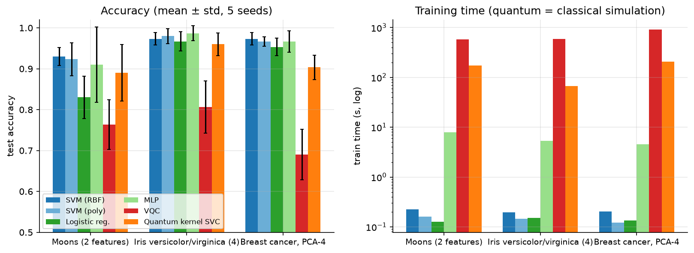
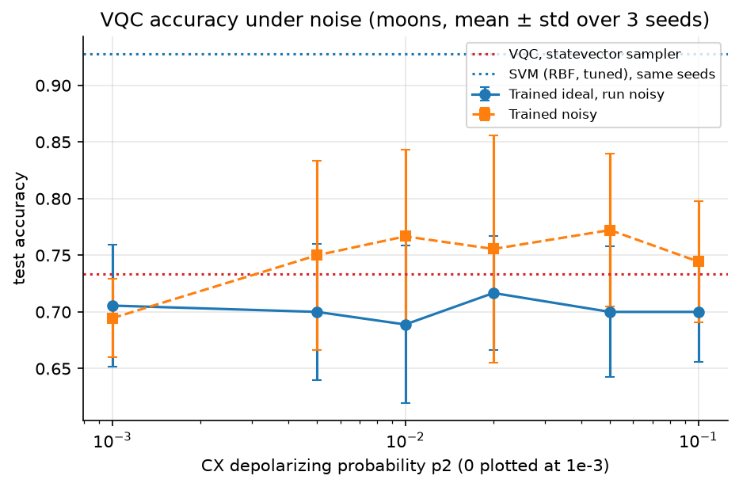
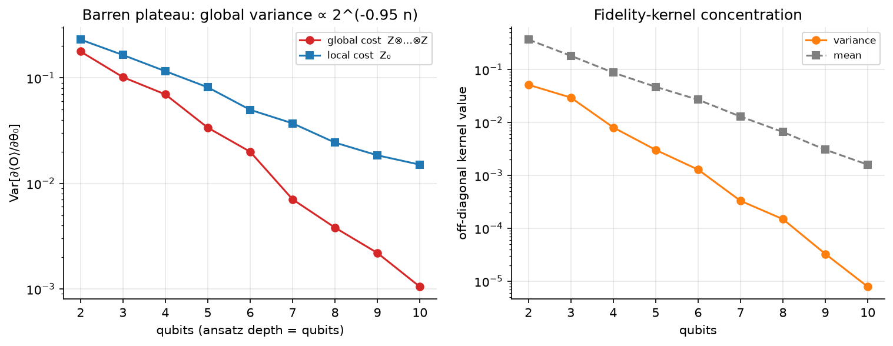

# qml-vs-classical

An honest benchmark of quantum classifiers against classical baselines, built on Qiskit 2.x, Qiskit Aer
and qiskit-machine-learning. It compares a variational quantum classifier (VQC) and a quantum-kernel
SVM with four classical models on three small datasets. Every model gets the same data, the same splits
and the same cross-validated tuning. It also looks at hardware noise and at the two effects that limit
scaling: barren plateaus and kernel concentration.



**Short version:** classical models win on all three datasets. The quantum kernel comes within 0.03 to
0.08 accuracy; the VQC trails by 0.18 to 0.29. Tuning matters a lot here: tuning both sides the same way
moves the quantum models by up to +0.19 and the classical ones by at most ±0.03. So a comparison that
tunes only one side can reach almost any conclusion.

## Problem

Quantum machine learning papers often report quantum models matching or beating classical ones on small
datasets. Those comparisons are easy to get wrong: preprocessing fitted on the whole dataset, one lucky
split, hyperparameters tuned for one side only, or baselines left at defaults. This project sets up the
comparison so that none of those can tip the result, then reports what comes out.

## Approach

| Step | Module | What it does |
|---|---|---|
| Data | `qmlbench.datasets` | Moons (200 points, 2 features), Iris versicolor vs virginica (100 points, 4 features) and Breast Cancer (PCA to 4 components, 200-point subsample). Stratified 70/30 splits for 5 seeds. Standardisation, PCA and scaling to `[0, π]` are **fitted on the training split only**. |
| Classical | `qmlbench.classical` | SVM (RBF), SVM (polynomial), logistic regression and an MLP (scikit-learn). |
| Quantum | `qmlbench.quantum` | VQC: `ZZFeatureMap` (reps 2) + `RealAmplitudes`, COBYLA (100 iterations), `SamplerV2` at 1,024 shots. Quantum kernel: `FidelityQuantumKernel` on the same feature map, passed to an SVC as a precomputed kernel. One qubit per feature. |
| Tuning | `qmlbench.tuning` | Every model searches a small grid (4 to 12 points), scored by **3-fold stratified CV on the training split**, then refits on the whole training split. The quantum grids cover feature scale (`[0, 1]` or `[0, π]`) plus ansatz depth (VQC, reps 1 or 3) or `C` (kernel). The test split is used once, for the final score. |
| Noise | `qmlbench.quantum` | Aer noise model on `{u, cx}`: CX depolarizing `p2`, single-qubit `p2/10`, readout flip `p2/2`, swept from 0 to 0.1. |
| Scaling | `qmlbench.scaling` | Exact statevector gradient variance (global vs local cost) and fidelity-kernel concentration from 2 to 10 qubits. |
| Runner | `scripts/run_benchmark.py` | Saves each (dataset, seed) result as soon as it finishes, so an interrupted run can be restarted. It also runs an untuned baseline with fixed defaults and the noise study. |

## Results

All numbers come from [`notebooks/qml_vs_classical.ipynb`](notebooks/qml_vs_classical.ipynb), which reads
the CSV files in [`results/`](results/). Accuracy is the test-set mean ± standard deviation over 5 seeds.

### Benchmark (tuned)

| Model | Moons | Iris | Breast cancer |
|---|---:|---:|---:|
| SVM (RBF) | **0.930 ± 0.022** | 0.973 ± 0.015 | **0.973 ± 0.015** |
| SVM (poly) | 0.923 ± 0.040 | 0.980 ± 0.018 | 0.967 ± 0.012 |
| Logistic regression | 0.830 ± 0.052 | 0.967 ± 0.024 | 0.953 ± 0.022 |
| MLP | 0.910 ± 0.092 | **0.987 ± 0.018** | 0.967 ± 0.026 |
| VQC | 0.763 ± 0.061 | 0.807 ± 0.064 | 0.690 ± 0.062 |
| Quantum kernel SVC | 0.890 ± 0.069 | 0.960 ± 0.028 | 0.903 ± 0.030 |

Comparing each seed with that seed's best classical model, the quantum kernel ties or wins on 4 of the 15
splits (3 of them on moons). The VQC never does. Training the quantum models in simulation takes about
70 to 900 seconds, compared with under 10 seconds for every classical model. That measures the cost of
simulating them classically and says nothing about real hardware.

### Effect of tuning

| Model | Moons | Iris | Breast cancer |
|---|---:|---:|---:|
| Best classical, gain from tuning | +0.007 | +0.007 | +0.003 |
| VQC, untuned → tuned | 0.637 → 0.763 | 0.633 → 0.807 | 0.610 → 0.690 |
| Quantum kernel, untuned → tuned | 0.723 → 0.890 | 0.813 → 0.960 | 0.713 → 0.903 |

For both quantum models, cross-validation picked `[0, 1]` feature scaling over `[0, π]` in **every one of
the 15 splits**. With wider rotation angles the encoded states spread across the Hilbert space, the
off-diagonal kernel entries shrink, and the data become harder to separate. This single preprocessing
choice accounts for most of the gap between a naive quantum model and a reasonable one. A benchmark that
tunes only the classical side, or only the quantum side, reaches the wrong conclusion.

### Noise



The VQC on moons, using the setting picked most often by CV (`[0, 1]` scale, ansatz reps 3), over 3 seeds:

| CX error `p2` | 0 | 0.005 | 0.01 | 0.02 | 0.05 | 0.1 |
|---|---:|---:|---:|---:|---:|---:|
| Trained ideal, run noisy | 0.706 | 0.700 | 0.689 | 0.717 | 0.700 | 0.700 |
| Trained noisy | 0.694 | 0.750 | 0.767 | 0.756 | 0.772 | 0.744 |

Accuracy is **flat within the error bars** up to 10% CX error. Training on the noisy simulator looks about
0.05 better, but the seed-to-seed spread is ±0.06 to ±0.09 with only 3 seeds, so that difference is not
meaningful. The 2-qubit moons circuit is shallow (about 7 CX), and the VQC is already limited by shot
noise, the optimiser budget and expressivity, so noise is not the bottleneck at this size. That would
change with deeper circuits.

### Scaling limits



| Qubits | 2 | 4 | 6 | 8 | 10 |
|---|---:|---:|---:|---:|---:|
| Var ∂⟨O⟩/∂θ₀, global cost | 0.178 | 0.070 | 0.020 | 0.0038 | 0.0011 |
| Var ∂⟨O⟩/∂θ₀, local cost | 0.231 | 0.116 | 0.050 | 0.024 | 0.015 |
| Mean off-diagonal kernel value | 0.370 | 0.088 | 0.027 | 0.0066 | 0.0016 |

The global-cost gradient variance falls roughly exponentially with qubit count (a barren plateau). The
local cost decays far more slowly. Fidelity-kernel entries between random points concentrate towards
zero at a similar rate, so the Gram matrix approaches the identity and the SVM can only memorise. Both
effects make the larger models needed for any real advantage harder to train, unless the cost function,
encoding or kernel bandwidth is designed around them. The `[0, 1]` scaling chosen by CV is a small
version of that bandwidth fix.

## What this does and does not show

* It shows that on small, low-dimensional problems where classical models are close to their ceiling,
  these quantum models do not catch up, even with fair tuning.
* It shows how much the comparison depends on encoding scale, and how easily asymmetric tuning would
  change the conclusion.
* It does **not** say anything about quantum advantage in general. These datasets have no structure a
  quantum feature map is known to exploit, and 2 to 4 qubits can be simulated exactly.

## How to run

Requires Python ≥ 3.10 (developed on Python 3.14, Qiskit 2.5, Qiskit Aer 0.17,
qiskit-machine-learning 0.9).

```bash
git clone https://github.com/spearpx/qml-vs-classical.git
cd qml-vs-classical
python -m venv .venv
.venv\Scripts\activate          # Windows; use `source .venv/bin/activate` on Linux/macOS
pip install -r requirements.txt
pip install -e .

pytest                          # 30 tests, ~30 s
jupyter notebook notebooks/qml_vs_classical.ipynb
```

The notebook reads the saved results and takes a few minutes. To regenerate the results themselves:

```bash
python scripts/run_benchmark.py --skip-noise                  # tuned benchmark, several hours
python scripts/run_benchmark.py --datasets iris --skip-noise  # or one dataset at a time, in parallel
python scripts/run_benchmark.py --untuned --skip-noise        # fixed-default baseline
python scripts/run_benchmark.py --noise-only                  # noise study, ~35 min
python scripts/make_notebook.py                               # rebuild the notebook from its source
```

Interrupted runs pick up where they stopped. Most of the time goes into tuning the VQC, which trains one
circuit per grid point, per fold and per seed.

## Project layout

```
src/qmlbench/
  datasets.py    leakage-free splits and preprocessing
  classical.py   scikit-learn baselines
  quantum.py     VQC, quantum kernel SVC, noise model
  tuning.py      symmetric 3-fold CV grid search for every model
  benchmark.py   benchmark and noise-study loops
  scaling.py     barren plateau and kernel concentration
scripts/
  run_benchmark.py   resumable benchmark runner
  make_notebook.py   generates the notebook
results/         per-dataset CSVs, noise.csv, run_info.json
notebooks/       qml_vs_classical.ipynb
figures/         plots used in this README
tests/           pytest suite
```

## Limitations

* **Simulation only.** No hardware run. The noise model is a simple, gate-independent depolarizing model.
* **Tiny problems.** 2 to 4 qubits and 70 to 140 training points. The breast cancer data are compressed
  to 4 PCA components, which discards information both model families could otherwise use.
* **Small grids.** Each model searches 4 to 12 settings. A larger search, or a different optimiser for
  the VQC (for example SPSA or gradient-based training with more iterations), could narrow the VQC gap.
  It is unlikely to close it on these data.
* **Few seeds.** 5 seeds for the benchmark and 3 for the noise study, so differences under about 0.05 are
  not resolved.
* **One feature map.** Only `ZZFeatureMap` was tested. Trainable or problem-specific encodings might do
  better, and are the obvious next step.

## License

[MIT](LICENSE)
